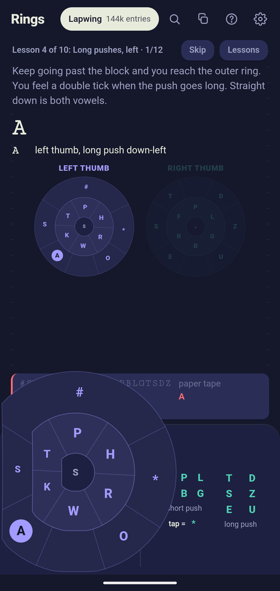
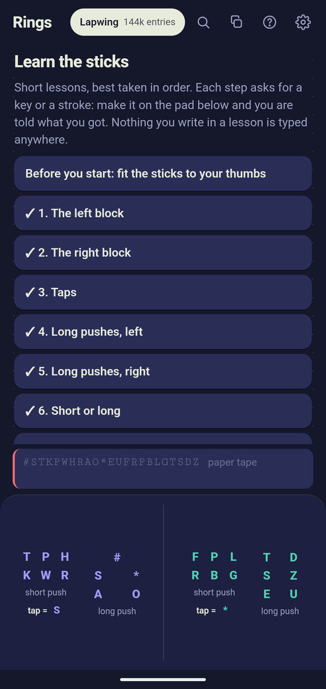
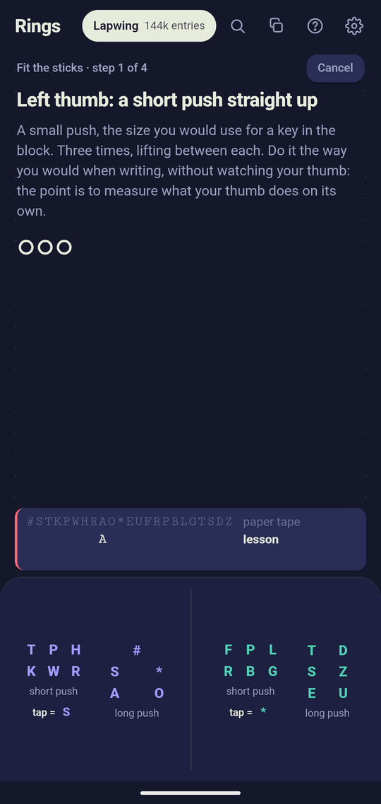
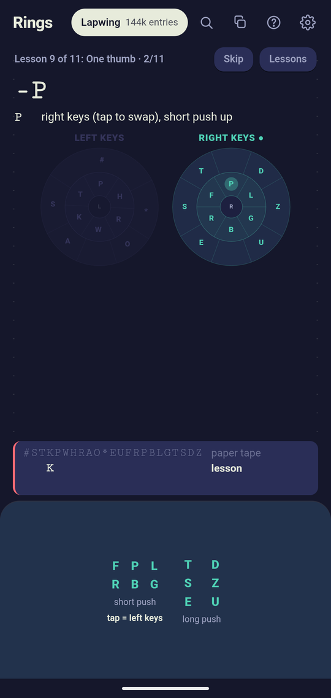
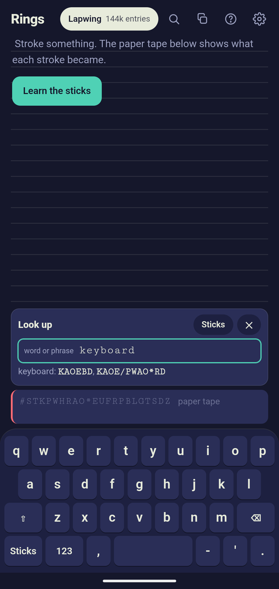
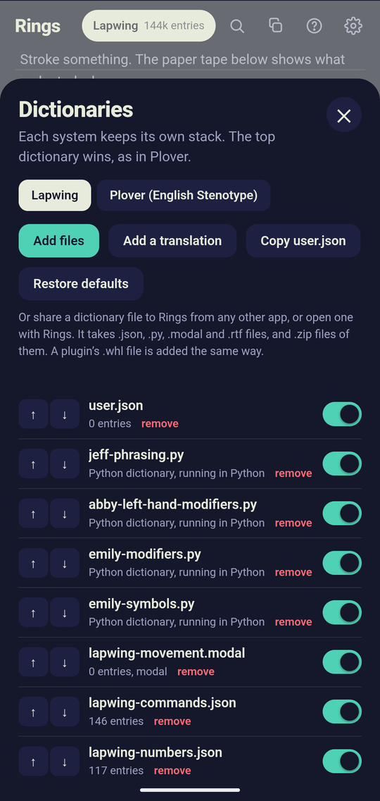
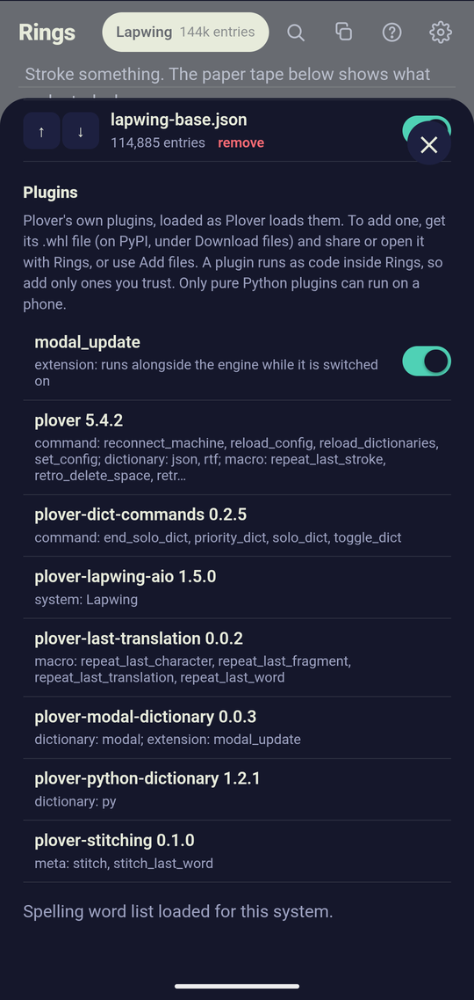
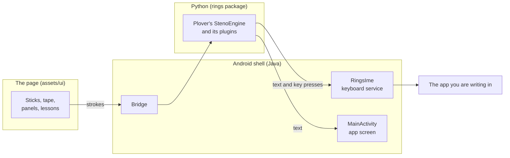

# Rings

**Stenography for two thumbs.** Rings is an Android keyboard that lets you write steno on a phone without looking at
your hands. Two floating thumb sticks stand in for the steno machine, and the real [Plover](https://www.openstenoproject.org/plover/)
engine does the translating.

<p align="center">
  
  
  
</p>

## Contents

- [What it is](#what-it-is)
- [How writing works](#how-writing-works)
- [Features](#features)
- [Install](#install)
- [Using it](#using-it)
- [How it is built](#how-it-is-built)
- [Development](#development)
- [Privacy and security](#privacy-and-security)
- [Limitations](#limitations)
- [License and credits](#license-and-credits)

## What it is

A steno machine has 23 keys and expects ten fingers. A phone gives you two thumbs and a sheet of glass you cannot
feel. Rings bridges that gap with a stick under each thumb:

- A stick opens **wherever your thumb lands**, so there is nothing to aim at.
- Each stick is a small copy of that hand's side of the steno board. You push toward where the key sits.
- Everything is confirmed by vibration and by a tape that shows what each stroke became, so your eyes stay on what you
  are writing.

It works as a system keyboard in any app, and it comes with an app screen for practice, lessons, dictionaries and
settings.

## How writing works


| You do | You get |
| --- | --- |
| **Short push** | A key from the block of six: `T P H / K W R` on the left, `F P L / R B G` on the right |
| **Long push** | The keys beyond the block: vowels below, `#` above, `S` and `*` to the sides, `T D S Z` on the right |
| **Tap** | The stick's click: `S` on the left, `*` (undo) on the right |
| **Roll** | Slide from one key onto its neighbour to take both |
| **Lift both thumbs** | After a short wait the stroke is sent |
| **One thumb** | A single stick does both hands: a tap swaps it between the left keys and the right |

A double tick tells you a push has gone long. A longer tick tells you the stroke has gone. Three ticks mean the
stroke had no entry.

Dead zones keep slips out: nothing counts until your thumb has clearly left the spot where it landed, the gaps
between keys belong to no key, and a touch that rests or slides a little does nothing.

Near a screen edge the stick is cut off flat so that all of it stays on screen. Every key keeps its direction, and
only the push toward the edge gets shorter.

<br clear="right">

## Features

- **The real Plover engine.** Plover 5.4.2 runs inside the app, with its own config, dictionaries, commands and
  plugin registry. Nothing is reimplemented.
- **Lapwing and Plover systems built in**, each with its own dictionary stack, including Lapwing's Python and modal
  dictionaries.
- **One-thumb mode** for writing with one hand, with a single stick that a tap swaps between the two sides.
- **Lessons** that teach the sticks step by step, and word drills drawn from whatever dictionaries you have loaded.
- **Fit the sticks to your thumbs.** Twelve test pushes set the distances and the tilt of each stick to match how your
  thumbs really move.
- **Live preview.** While you build a stroke, the tape shows what it will become.
- **Shorter-outline hints** when you write something the long way.
- **Look up and Add translation** panels, opened by the same strokes as in Plover, with a letter keyboard for typing
  words you cannot stroke yet.
- **Dictionaries and plugins.** Add `.json`, `.py`, `.modal`, `.rtf` or `.zip` files, or a plugin's `.whl`, by
  picking them, sharing them, or opening them with Rings.
- **Settings for everything**: every distance, angle and delay has a slider and a number box.
- **No internet permission.** A keyboard sees everything you type. This one has no way to send it anywhere.

## Install

You need an arm64 phone running Android 11 or later.

1. Build the APK (see [Development](#development)) or take one from a release, then install it:

   ```sh
   adb install -r app/build/outputs/apk/release/rings-1.0.0-release.apk
   ```

2. Open **Rings**. A banner offers to take you to the phone's keyboard settings. Switch **Rings steno** on there.
3. Choose Rings from the keyboard switcher whenever you want to write steno.

The first launch opens on the lessons. Start with **Fit the sticks to your thumbs**.

## Using it

### Lessons and fitting

<p>
  
  
</p>

Eleven short lessons go from single keys to rolls, one-thumb writing and whole words. Each step names a key or stroke, says how to make it,
and shows a picture of each stick that lights up with what your thumb is holding. Nothing you write in a lesson is
typed anywhere.

Fitting asks for short and long pushes straight up with each thumb. From those it sets the dead zone, the distance
where a long push begins, and how far each stick is turned so that your thumb's natural "up" counts as up.

### One thumb



Choose **One** under Thumbs in Settings, or tap the two-ring button beside the keyboard's tape, and the pad becomes a
single stick you can land on anywhere.

- Every stroke starts on the **left keys**.
- A quick **tap** swaps the stick to the **right keys**, and another tap swaps it back.
- Two ticks say right, one says left, and the pad changes colour with the side it is on.
- Once the stroke is sent the stick is back on the left. A tap on its own keeps for as long as you take.

With one thumb, `S` and `*` are long pushes on the left keys (left and right), because the tap is busy swapping.
The same button or setting takes you back to two thumbs.

<br clear="right">

### Look up and Add translation

<p>
  
  
</p>

Both panels open from the buttons beside the tape (magnifier and plus), or from your dictionary's own strokes for `{PLOVER:LOOKUP}` and
`{PLOVER:ADD_TRANSLATION}`.

- **Look up** uses plain letter keys, because fingerspelling a word to find its outline is no fun.
- **Add translation** works as it does in Plover: write or fingerspell a word, stroke `TKUPT`, and the panel opens
  with that word filled in and the cursor waiting for the strokes. `Tab` changes field, `Return` saves, `Escape` closes.

### Dictionaries and plugins

<p>
  
  
</p>

Tap the system name at the top of the app to open the stack. The top dictionary wins, as in Plover. Each system keeps
its own stack in Plover's own config file.

Three ways to add files:

1. **Add files** in the panel, which opens the phone's file picker.
2. **Share** a file to Rings from any app.
3. **Open with** Rings from a file manager or a download.

Plugins are added the same way from their `.whl` file (on PyPI, under "Download files"). Only pure Python plugins
can run on a phone. Extensions, such as the one Lapwing's movement dictionary needs, have a switch in the same panel.

### Settings

Open them with the gear, on the app screen or beside the keyboard's tape. Every Low, Medium, High choice is a slider
with a number box. The ones worth knowing first:

| Setting | What it does |
| --- | --- |
| Thumbs | Two sticks, or one stick that a tap swaps between sides |
| Dead zone | How far a thumb moves before anything counts |
| Long push | How far out the outer keys begin |
| Wait before sending | How long you have to land a thumb again before the stroke is sent |
| Rolls | Whether going back over a key drops it, the steno-order skip rule, or keep everything |
| Vibration and Sound | Strength of the ticks, from 0 (off) to 100 |
| Arpeggiate | Build a stroke one key at a time with no clock, then press Send |

**Reset every setting** puts all of them back.

## How it is built



- **The page** is the whole interface: one web page shown in full on the app screen, and as just the tape and pad in
  the keyboard. It turns touches into steno strokes and draws everything.
- **The shell** hosts the page in a WebView, gives it a small bridge to the phone (haptics, clipboard, keyboard
  switching), and types Plover's output into whatever app has the cursor.
- **The engine** is Plover, started headless by the `rings` Python package through [Chaquopy](https://chaquo.com/chaquopy/).
  The package only starts Plover, feeds it strokes and reports what it typed. It translates nothing itself.

### Project layout

```
app/src/main/
  assets/ui/            The page
    index.html
    app.css
    js/
      steno.js          Steno keys and strokes
      core.js           Bridge, settings, feedback
      page.js           Practice page, tape, sending a stroke
      rollmap.js        Roll table for the "Backward skips" rule (GPL, from plover_controller)
      sticks.js         Reading touches into keys
      panel.js          Look up and Add translation
      lessons.js        Lessons and fitting
      library.js        Dictionaries and plugins
      settings.js       Settings and guide
      main.js           Start-up and what the app calls back into
  java/app/rings/steno/
    App.java            Starts Plover with the process
    Plover.java         The door to the Python engine
    Page.java           The WebView showing the page
    Bridge.java         What the page can ask of the phone
    KeyboardHost.java   What only the keyboard can do for the page
    RingsIme.java       The keyboard service
    Editor.java         Types Plover's output into other apps
    Haptics.java        The vocabulary of ticks
    MainActivity.java   The app screen
  python/rings/
    api.py              The one entry point: call(method, json)
    core.py             Starting Plover and reaching its engine thread
    strokes.py          Strokes, previews, hints
    dictionaries.py     Systems, stacks, lookup, adding files
    plugins.py          Listing, adding and removing plugins
    panels.py           Translator states for the two panels
    status.py           What the page shows about the engine
native/build_wheels.py  Builds Plover's two C helpers for arm64
wheels/                 The built helpers
tests/                  Engine tests and an on-device check
```

## Development

### Requirements

- JDK 17
- Android SDK with platform 35 (`sdk.dir` in `local.properties`, or `ANDROID_HOME`)
- Python 3.11 on the `PATH` (Chaquopy uses it at build time)

### Build

```sh
./gradlew assembleDebug        # app/build/outputs/apk/debug/rings-1.0.0-debug.apk
./gradlew assembleRelease      # app/build/outputs/apk/release/rings-1.0.0-release.apk
```

The debug build turns on WebView debugging so the page can be inspected over adb. The release build does not.

### Signing a release

Without any setup, release builds are signed with the debug key. That installs fine on your own phone, but it is not
a key to hand an app out with. To use your own, create `keystore.properties` beside `settings.gradle`:

```properties
storeFile=/path/to/your.jks
storePassword=...
keyAlias=...
keyPassword=...
```

The file and any keystore are ignored by git.

### Tests

```sh
# The engine wrapper against a desktop install of the same Plover and plugins
pip install --no-deps plover==5.4.2 plover-lapwing-aio plover-python-dictionary plover-modal-dictionary \
    plover-stitching plover-last-translation plover-dict-commands
pip install appdirs pyserial plover_stroke rtf_tokenize
python tests/test_engine.py

# The page inside the app, on a phone with a debug build open (needs Playwright for Python)
python tests/device_check.py
```

The device check makes real strokes on the app screen and puts back any settings it changes.

### Rebuilding the native helpers

Plover needs two small C extensions, `plover_stroke` and `rtf_tokenize`, and PyPI has no Android builds of them.
`native/build_wheels.py` compiles the unmodified source releases with the NDK against Chaquopy's Python and writes
the wheels the app build installs. It checks each source archive against a pinned SHA-256 first. Run it again only
if the Python version, those packages, or the ABI change.

## Privacy and security

- The app requests **no internet permission**. Its only permission is vibration.
- **Files from other apps are never added silently.** Anything shared to Rings or opened with it is shown to you
  first, with a warning when it contains code.
- **Python dictionaries and plugins run as code** inside the keyboard, exactly as they do in Plover on a computer.
  Add only ones you trust.
- **In password boxes the tape shows nothing** of what you write.
- Plover's stroke and translation logs are kept switched off, so what you type is never written to a file.
- The page can load only its own files and cannot navigate anywhere else.

## Limitations

- arm64 phones only, Android 11 or later.
- English systems only for now (Lapwing and Plover's English Stenotype).
- Plugins with compiled code cannot be added, and there is no install-by-name from PyPI because the app is offline
  by design.
- Machine and window plugins are not loaded: there is no steno hardware to open and no desktop to draw on.
- A stroke that needs a block key and an outer key on the same hand takes two pushes.

## License and credits

Rings' own code is under the [MIT License](LICENSE).

The app would be nothing without the work it stands on, above all **Plover** by the
[Open Steno Project](https://www.openstenoproject.org/). Plover and most of its plugins are under the GNU General
Public License, and they are packaged inside the APK. That means a built APK, as a whole, is distributed under the
terms of the GPL (version 3 or later, once every bundled plugin is counted), with this repository as its source.

[THIRD_PARTY_NOTICES.md](THIRD_PARTY_NOTICES.md) lists every bundled component with its author and license.
