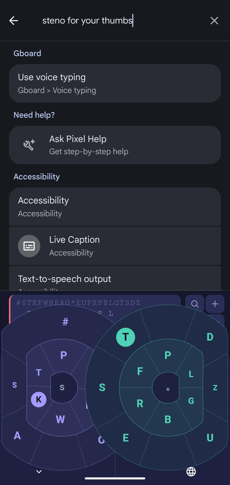
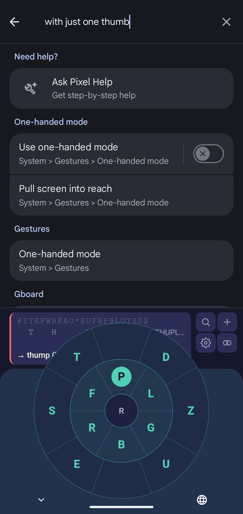
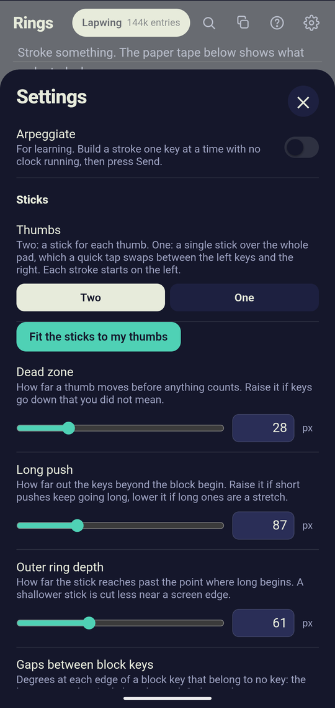
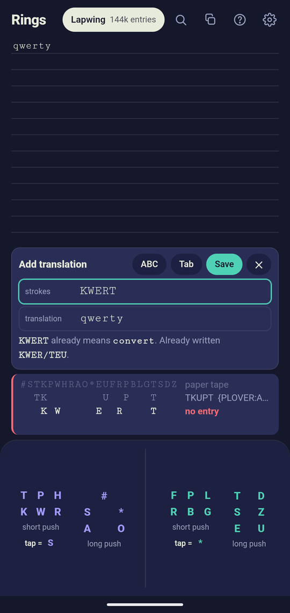
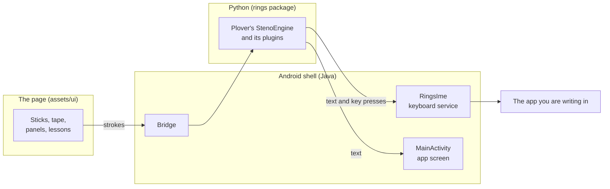

# Rings

Rings is a steno keyboard for Android that you write on with your thumbs, two of them or just one, without looking at
your hands. Floating thumb sticks stand in for the steno machine, and the real
[Plover](https://www.openstenoproject.org/plover/) engine does the translating.

<p align="center">
  
  
  
  
</p>

## Contents

- [What it is](#what-it-is)
- [How writing works](#how-writing-works)
- [Features](#features)
- [Install](#install)
- [Using it](#using-it)
- [How it is built](#how-it-is-built)
- [Development](#development)
- [Privacy and security](#privacy-and-security)
- [Limitations](#limitations)
- [License and credits](#license-and-credits)

## What it is

A steno machine has 23 keys and wants all ten fingers. On a phone you get two thumbs, sometimes only one, and glass
you can't feel. So Rings puts a stick under each thumb, or one stick that a single thumb swaps between the two sides.

- A stick opens wherever your thumb lands, so there's nothing to aim at.
- Each stick is a small copy of that hand's side of the steno board. You push toward where the key sits.
- Vibration tells you what happened and a tape shows what each stroke became, so you can keep your eyes on what
  you're writing.

It's a system keyboard, so it works in any app. The app itself has a practice page, lessons, dictionaries and
settings.

## How writing works


- **Short push**: a key from the block of six, `T P H / K W R` on the left and `F P L / R B G` on the right.
- **Long push**: the keys beyond the block. Vowels below, `#` above, `S` and `*` to the sides, `T D S Z` on the right.
- **Tap**: the stick's click, `S` on the left and `*` (undo) on the right.
- **Roll**: slide from one key onto its neighbor to take both.
- **Lift both thumbs**: after a short wait the stroke is sent.
- **One thumb**: a single stick does both hands. A tap swaps it between the left keys and the right, and two taps
  make `*`.

A double tick means the push went long. A longer tick means the stroke was sent, and three ticks mean it had no
entry.

Dead zones keep slips out. Nothing counts until your thumb has clearly left the spot where it landed, the gaps
between keys belong to no key, and a touch that rests or slides a little does nothing.

Near a screen edge the stick is cut off flat so all of it stays on screen. Every key keeps its direction, and only
the push toward the edge gets shorter.

<br clear="right">

## Features

- Plover 5.4.2 itself runs inside the app, with its own config, dictionaries, commands and plugin registry.
- Lapwing and Plover (English Stenotype) are built in, each with its own dictionary stack. Lapwing's Python and modal
  dictionaries work.
- One-thumb mode: a single stick that a tap swaps between the two sides.
- Lessons that teach the sticks step by step, plus word drills drawn from whatever dictionaries you have loaded.
- Fitting: twelve test pushes set the distances and the tilt of each stick to how your thumbs move.
- A live preview on the tape of what the stroke you're building will become.
- A hint when there's a shorter outline for what you just wrote.
- Look up and Add translation panels, opened by the same strokes as in Plover, with a letter keyboard for words you
  can't stroke yet.
- Add `.json`, `.py`, `.modal`, `.rtf` or `.zip` files, or a plugin's `.whl`, by picking them, sharing them, or
  opening them with Rings.
- A slider and a number box for every distance, angle and delay.
- No internet permission. The keyboard has no way to send what you type anywhere.

## Install

You need an arm64 phone running Android 11 or later.

1. Download the APK from the [latest release](https://github.com/RAOEUS/rings-steno/releases/latest) and open it on
   the phone. Android asks once to let your browser or file manager install apps. Or build it yourself (see
   [Development](#development)) and install it over USB:

   ```sh
   adb install -r app/build/outputs/apk/release/rings-1.1.0-release.apk
   ```

2. Open **Rings**. A banner offers to take you to the phone's keyboard settings. Switch **Rings steno** on there.
3. Choose Rings from the keyboard switcher whenever you want to write steno.

The first launch opens on the lessons. Start with **Fit the sticks to your thumbs**.

## Using it

### Lessons and fitting

<p>
  
  
</p>

Eleven short lessons go from single keys to rolls, one-thumb writing and whole words. Each step names a key or
stroke, says how to make it, and shows a picture of each stick that lights up with what your thumb is holding.
Nothing you write in a lesson gets typed anywhere.

Fitting asks for short and long pushes straight up with each thumb. From those it sets the dead zone, the distance
where a long push begins, and how far each stick is turned so that your thumb's natural "up" counts as up.

### One thumb


Choose **One** under Thumbs in Settings, or tap the two-ring button beside the keyboard's tape, and the pad becomes a
single stick you can land on anywhere.

- Every stroke starts on the **left keys**.
- A quick **tap** swaps the stick to the **right keys**.
- A tap while you're on the right keys is `*`, and takes you back to the left. So **two taps make `*`** from either
  side, and leave the stick where it was.
- Two ticks say right, one says left, and the pad changes color with the side it's on.
- Once the stroke is sent the stick is back on the left. If you tap and then wait, it stays swapped until you write
  the stroke.

With one thumb, `S` is a long push left on the left keys, because the tap is busy swapping. `*` is there too, out to
the right. The same button or setting takes you back to two thumbs.

<br clear="right">

### Look up and Add translation

<p>
  
  
</p>

Both panels open from the buttons beside the tape (magnifier and plus), or from your dictionary's own strokes for
`{PLOVER:LOOKUP}` and `{PLOVER:ADD_TRANSLATION}`.

- **Look up** uses plain letter keys, because fingerspelling a word to find its outline is no fun.
- **Add translation** works the way it does in Plover. Write or fingerspell a word, stroke `TKUPT`, and the panel opens
  with that word filled in and the cursor waiting for the strokes. `Tab` changes field, `Return` saves, `Escape` closes.

### Dictionaries and plugins

<p>
  
  
</p>

Tap the system name at the top of the app to open the stack. The top dictionary wins, as in Plover. Each system keeps
its own stack in Plover's own config file.

You can add files three ways:

1. **Add files** in the panel, which opens the phone's file picker.
2. **Share** a file to Rings from any app.
3. **Open with** Rings from a file manager or a download.

Plugins go in the same way, from their `.whl` file (on PyPI, under "Download files"). Only pure Python plugins can
run on a phone. Extensions, like the one Lapwing's movement dictionary needs, have a switch in the same panel.

### Settings

Open them with the gear, on the app screen or beside the keyboard's tape. Every distance, angle and delay is a
slider with a number box next to it. The ones worth knowing first:

| Setting | What it does |
| --- | --- |
| Thumbs | Two sticks, or one stick that a tap swaps between sides |
| Dead zone | How far a thumb moves before anything counts |
| Long push | How far out the outer keys begin |
| Wait before sending | How long you have to land a thumb again before the stroke is sent |
| Rolls | Whether going back over a key drops it, the steno-order skip rule, or keep everything |
| Vibration and Sound | Strength of the ticks, from 0 (off) to 100 |
| Arpeggiate | Build a stroke one key at a time with no clock, then press Send |

**Reset every setting** puts all of them back.

## How it is built



- **The page** is the whole interface. It's one web page, shown in full on the app screen and as only the tape and
  pad in the keyboard. It turns touches into steno strokes and draws everything.
- **The shell** hosts the page in a WebView, gives it a small bridge to the phone (haptics, clipboard, keyboard
  switching), and types Plover's output into whatever app has the cursor.
- **The engine** is Plover, started headless by the `rings` Python package through [Chaquopy](https://chaquo.com/chaquopy/).
  The package starts Plover, feeds it strokes and reports back what it typed. All the translating is Plover's.

### Project layout

```
app/src/main/
  assets/ui/            The page
    index.html
    app.css
    js/
      steno.js          Steno keys and strokes
      core.js           Bridge, settings, feedback
      page.js           Practice page, tape, sending a stroke
      rollmap.js        Roll table for the "Backward skips" rule (GPL, from plover_controller)
      sticks.js         Reading touches into keys
      panel.js          Look up and Add translation
      lessons.js        Lessons and fitting
      library.js        Dictionaries and plugins
      settings.js       Settings and guide
      main.js           Start-up and what the app calls back into
  java/app/rings/steno/
    App.java            Starts Plover with the process
    Plover.java         Calls into the Python engine
    Page.java           The WebView showing the page
    Bridge.java         What the page can ask of the phone
    KeyboardHost.java   What only the keyboard can do for the page
    RingsIme.java       The keyboard service
    Editor.java         Types Plover's output into other apps
    Haptics.java        The vibration patterns
    MainActivity.java   The app screen
  python/rings/
    api.py              The one entry point: call(method, json)
    core.py             Starting Plover and reaching its engine thread
    strokes.py          Strokes, previews, hints
    dictionaries.py     Systems, stacks, lookup, adding files
    plugins.py          Listing, adding and removing plugins
    panels.py           Translator states for the two panels
    status.py           What the page shows about the engine
native/build_wheels.py  Builds Plover's two C helpers for arm64
wheels/                 The built helpers
tests/                  Engine tests and an on-device check
```

## Development

### Requirements

- JDK 17
- Android SDK with platform 35 (`sdk.dir` in `local.properties`, or `ANDROID_HOME`)
- Python 3.11 on the `PATH` (Chaquopy uses it at build time)

### Build

```sh
./gradlew assembleDebug        # app/build/outputs/apk/debug/rings-1.1.0-debug.apk
./gradlew assembleRelease      # app/build/outputs/apk/release/rings-1.1.0-release.apk
```

The debug build turns on WebView debugging so you can inspect the page over adb. The release build doesn't.

### Signing a release

With no setup, release builds are signed with the debug key. That's fine for your own phone but not for an APK you
give to other people. To use your own key, create `keystore.properties` beside `settings.gradle`:

```properties
storeFile=/path/to/your.jks
storePassword=...
keyAlias=...
keyPassword=...
```

Git ignores that file and any keystore.

### Tests

```sh
# The engine wrapper against a desktop install of the same Plover and plugins
pip install --no-deps plover==5.4.2 plover-lapwing-aio plover-python-dictionary plover-modal-dictionary \
    plover-stitching plover-last-translation plover-dict-commands
pip install appdirs pyserial plover_stroke rtf_tokenize
python tests/test_engine.py

# The page inside the app, on a phone with a debug build open (needs Playwright for Python)
python tests/device_check.py
```

The device check makes real strokes on the app screen and puts back any settings it changes.

### Rebuilding the native helpers

Plover needs two small C extensions, `plover_stroke` and `rtf_tokenize`, and PyPI has no Android builds of them.
`native/build_wheels.py` compiles the unmodified source releases with the NDK against Chaquopy's Python and writes
the wheels the app build installs. It checks each source archive against a pinned SHA-256 first. You only need to
run it again if the Python version, those packages, or the ABI change.

## Privacy and security

- The app asks for no internet permission. Its only permission is vibration.
- Files from other apps are never added silently. Anything shared to Rings or opened with it is shown to you first,
  with a warning when it contains code.
- Python dictionaries and plugins run as code inside the keyboard, the same as they do in Plover on a computer. Only
  add ones you trust.
- In password boxes the tape shows nothing of what you write.
- Plover's stroke and translation logs are kept switched off, so what you type is never written to a file.
- The page can load only its own files and can't navigate anywhere else.

## Limitations

- arm64 phones only, Android 11 or later.
- English systems only for now (Lapwing and Plover's English Stenotype).
- Plugins with compiled code can't be added, and there's no install-by-name from PyPI because the app has no
  internet access.
- Machine and window plugins aren't loaded, since there's no steno hardware to open and no desktop to draw on.
- A stroke that needs a block key and an outer key on the same hand takes two pushes.

## License and credits

Rings' own code is under the [MIT License](LICENSE).

Rings runs on Plover by the [Open Steno Project](https://www.openstenoproject.org/) and wouldn't exist without it.
Plover and most of its plugins are under the GNU General Public License, and they're packaged inside the APK. So a
built APK, as a whole, is distributed under the terms of the GPL (version 3 or later, once every bundled plugin is
counted), with this repository as its source.

[THIRD_PARTY_NOTICES.md](THIRD_PARTY_NOTICES.md) lists every bundled component with its author and license.
